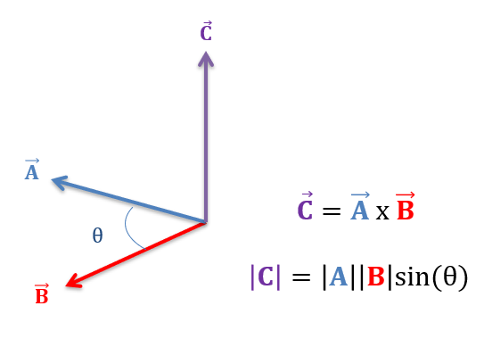

# CUBE WORLD!!!!!!!

This project uses WebGL

## Documentation

### Groups

So this project works by having a main engine that sort of acts like an drawing API. There you can define "groups" which are a collection on vertices and edges that can be moved together efficently. You can make a group with the `addGroup()` function. This function works by adding the vertices and indecies into the `idx` and `verts` arrays which are used later on to fill the gpu buffers. It also makes an entry to the `group` dictionary which defines an array `inputs` - which is an array of length 9 that determines how much to move the group the first three elements correlate to the x, y, and z positions while the next 3 correlate to the x, y, and z scale and the last three correlate to the x, y, and z rotation. The `group` dictionary also holds `start` and `count` integers. `start` correlate to where in the `idx` array the group starts and `g.count` is how many indices there are in the group. This is used later for making a draw call for each group. 

### Uploading to GPU Buffer

Before we can talk about the vertex or fragment shader we must set up the GPU Buffer to use it properly. This work is done in the `upload()` function and it looks like this:

```js
// Do all the rendering shenanigans in one function 
function upload() {
  gl.bindBuffer(gl.ARRAY_BUFFER, gl.createBuffer());
  gl.bufferData(gl.ARRAY_BUFFER, new Float32Array(verts), gl.STATIC_DRAW);
  gl.bindBuffer(gl.ELEMENT_ARRAY_BUFFER, gl.createBuffer());
  gl.bufferData(gl.ELEMENT_ARRAY_BUFFER, new Uint32Array(idx), gl.STATIC_DRAW);

  const aPos = gl.getAttribLocation(prog, "aPos");
  gl.enableVertexAttribArray(aPos);
  gl.vertexAttribPointer(aPos, 3, gl.FLOAT, false, 24, 0);

  const aCol = gl.getAttribLocation(prog, "aCol");
  gl.enableVertexAttribArray(aCol);
  gl.vertexAttribPointer(aCol, 3, gl.FLOAT, false, 24, 12);

  gl.enable(gl.DEPTH_TEST);
  gl.enable(gl.CULL_FACE);
  gl.clearColor(0.1, 0.1, 0.15, 1);
}
```

The first line in the function will create a buffer in the GPU for us to use in the `ARRAY_BUFFER` the next line then loads all of our `verts` array into this GPU buffer (**Note**: We cast to a `Float32Array` because the GPU shader only works with 32bit floats or ints packed side by side in memory while JS arrays are 64bit). The next two lines also then load our `idx` array into the `ELEMENT_ARRAY_BUFFER` into the GPU (**Note**: we have to cast to `Uint32Array` for the same reason above but because it is discrete non-negative values we can use a 32 bit Unsigned Integer array). 

### Drawing the view

Drawing the actual view is done via the `drawView` function. Which looks like this: 

```js
function drawView(view) {
    const c = document.getElementById("c");
    const proj = perspective(Math.PI/2, c.width / c.height, 1, 100000);
    const projView = multiply(proj, view);

    gl.clear(gl.COLOR_BUFFER_BIT | gl.DEPTH_BUFFER_BIT);
    for (const g of Object.values(groups)) {
        const mvp = multiply(projView, buildModel(...g.inputs));
        gl.uniformMatrix4fv(uMVP, true, new Float32Array(mvp));

        // so we dont hit the 3 mil limit check if we are trying to do more than 3 mil on draw 3 mil at a time
        const MAX_INDICES = 3_000_000; // 3 mil indices per draw
        for (let offset = 0; offset < g.count; offset += MAX_INDICES) {
            const count = Math.min(MAX_INDICES, g.count - offset);
            //console.log("Drawing:", count, "indices; group total:", g.count);
            gl.drawElements(
                gl.TRIANGLES,
                count,
                gl.UNSIGNED_INT,
                (g.start + offset) * Uint32Array.BYTES_PER_ELEMENT
            );
        }

    }
}
```

This function takes in a view matrix and uses it to build `projView` the projection matrix multiplied by the view matrix (click here to learn how the projection matrix works). It then loops through every group and draws them one at a time. For each group it first builds the model-view-projection (MVP) matrix by combining that group’s model matrix with `projView`. This matrix is uploaded to the vertex shader’s matrix uniform, and it is re-uploaded for every group because each group has its own model matrix.

Next, we draw the group’s indices in chunks of up to 3 million. If a group has fewer than 3 million indices this takes a single draw call. If it has more it takes multiple draw calls. The reason is that the WebGL spec doesn’t set a hard limit on index count but in my testing the scene would not load when I tried to draw more than 3 million indices in a single call.

### Perspective and lookAt

The `perspective()` function takes in an `fov` in radians, the `aspect` ratio of the canvas, and the `near` and `far` values. It will then calculate a standard perspective matrix. 

```js
function perspective(fov, aspect, near, far) {
    const f = 1 / Math.tan(fov / 2)
    const nf = 1 / (near - far);
    return [
        f/aspect, 0, 0,               0,
        0,        f, 0,               0,
        0,        0, (far+near)*nf,   2*far*near*nf,
        0,        0, -1,              0,
    ];
}
```

### The Projection Matrix

### Perspective

The `perspective()` function takes in an `fov` in radians, the `aspect` ratio of the canvas, and the `near` and `far` values. It will then calculate a standard perspective matrix. This is how the code looks: 

```js
function perspective(fov, aspect, near, far) {
    const f = 1 / Math.tan(fov / 2)
    const nf = 1 / (near - far);
    return [
        f/aspect, 0, 0,               0,
        0,        f, 0,               0,
        0,        0, (far+near)*nf,   2*far*near*nf,
        0,        0, -1,              0,
    ];
}
```

The matrix that is returned will scale x and y by `f` (x is also divided by `aspect`), and its bottom row copies `-z` into `w`. After the vertex shader, the GPU divides by `w`, which is the same as dividing by -z, to complete their perspective calculations into the range [-1, 1]. Z will have to map all values from [near, far] to [-1, 1]. This is done with the 3rd row by multiplying z by `(far+near)*nf` and then adding it to `2*far*near*nf`. After the divide by `w`, `near` ends up at -1 and `far` ends up at 1.

### LookAt

The `lookAt()` function will take in the world coordinates and given the coordinates of the eye (camera), the coordinates of the target (what to look at), and the coordinates of the up position of the camera. It will then translate the world coordinates into the coordinates relative to the camera (view coordinates). It works by first moving the camera (along with everthing else to 0,0,0) then running a change of bases from the world coordinates to the camera coordintes. This is how the code looks:

```js
function normalize(v) { const l = Math.hypot(...v); return v.map(a => a / l); }
function cross(a, b) { return [a[1]*b[2]-a[2]*b[1], a[2]*b[0]-a[0]*b[2], a[0]*b[1]-a[1]*b[0]]; }
function dot(a, b)   { return a[0]*b[0] + a[1]*b[1] + a[2]*b[2]; }

function lookAt(eye, target, up) {
    const f = normalize([target[0]-eye[0], target[1]-eye[1], target[2]-eye[2]]); // forward vector of camera
    const s = normalize(cross(f, up));                                           // right vector of camera
    const u = cross(s, f);                                                       // true up vector of camera
    return [
         s[0],  s[1],  s[2], -dot(s, eye),
         u[0],  u[1],  u[2], -dot(u, eye),
        -f[0], -f[1], -f[2],  dot(f, eye),
         0,     0,     0,     1,
    ];
}
```

`f` is the forward unit vector of the camera. It works by simply subtracting the eye from the target. 

Then `s` is the right vector which is done by taking the cross product of the forward and up vectors which will return the vector orthagonal to both of them:


Then `u` is the true up vector of the camera. It also uses the cross product trick to get the vector that is orthogonal to forward and right, which will be the up vector of the camera.

You then build the matrix by having the first row be the x, y, and z coordinates of the right vector. This will dot the right vector with the point we are passing through. That is essentially saying how much the point extends along the right vector. A value of 1 means that the point fits one unit of the right vector in it. A value of 0.5 means that the point fits half a unit of the right vector in it. This is how many units of right are in our point. We then do this trick for up and backward (the third row uses `-f`, since the camera looks down -Z). This will move the x, y, z coordinates into right, up, and backward coordinates. The last column moves the camera to (0, 0, 0) and brings all of the other points with it.


### Objects

The complex objects were made by first making them in blender and then exporting them as object files. I then parse the object file with the `parseObj` function.


